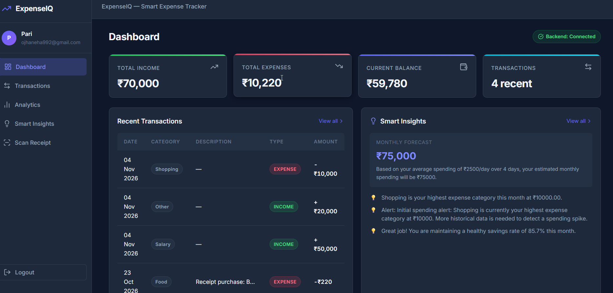
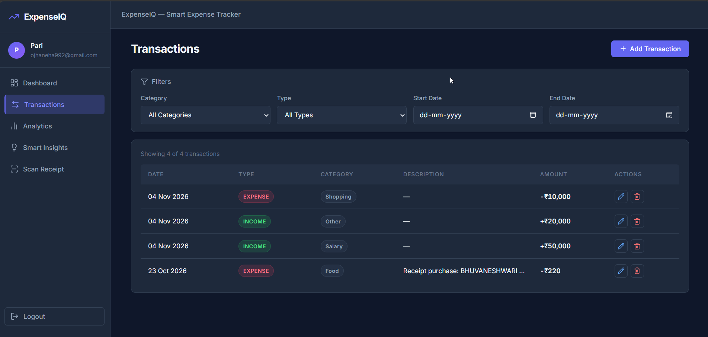
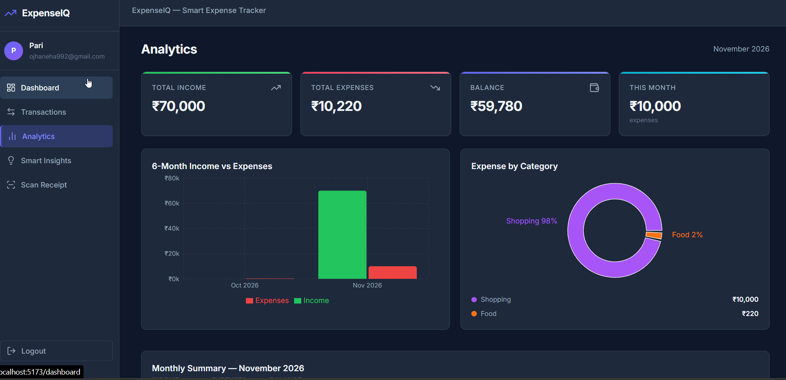
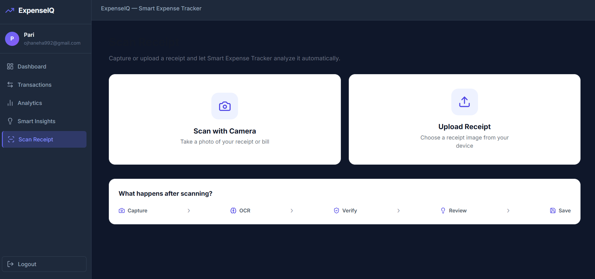

# Smart Expense Tracker 💰

A full-stack personal finance management application designed to help users track income and expenses, scan receipts, analyze spending patterns, and make smarter financial decisions.

Smart Expense Tracker combines transaction management, receipt scanning, financial analytics, and intelligent spending insights in one platform.

## 🚀 Features

### 1. Dashboard

* View total income, expenses, and available balance.
* Get an overview of recent transactions.
* Monitor your financial activity through visual summaries.

### 2. Transaction Management

* Add, edit, and delete income and expense transactions.
* Organize transactions by category.
* View and filter transaction history.
* Manage financial records in one place.

### 3. Receipt Scanner & OCR

* Capture receipts or upload receipt images.
* Extract information from receipts using Optical Character Recognition (OCR).
* Identify important details such as transaction amount, date, and merchant information.
* Review extracted information before saving it.
* Integrate scanned receipt details into transaction management.

### 4. Financial Analytics

* Analyze income and expenses.
* Visualize spending patterns.
* Explore category-wise expenses.
* Understand monthly financial activity.

### 5. Smart Financial Insights

* Identify unusual spending patterns.
* Detect significant increases in category-wise expenses.
* Estimate future spending using historical data.
* Generate recommendations to support better financial decisions.

### 6. Authentication & Security

* User registration and login.
* JWT-based authentication.
* Protected API routes.
* User-specific transaction access and data isolation.

---
## 📸 Application Screenshots

### Dashboard
Overview of income, expenses, balance and recent financial activity.



### Transaction Management
View, add, edit and manage financial transactions.



### Financial Analytics
Visualize spending patterns and analyze expenses by category.



### Receipt Scanner & OCR
Capture or upload receipts and automatically extract transaction details.



## 🛠️ Technology Stack

| Layer              | Technologies               |
| ------------------ | -------------------------- |
| Frontend           | React.js, Vite, JavaScript |
| Styling            | CSS                        |
| Backend            | Node.js, Express.js        |
| Database           | MongoDB, Mongoose          |
| Authentication     | JSON Web Tokens (JWT)      |
| Receipt Processing | Tesseract.js, Sharp        |
| API Testing        | Postman                    |
| Code Quality       | ESLint                     |
| Version Control    | Git, GitHub                |

---

## 📂 Project Structure

```text
smart-expense-tracker/
│
├── backend/
│   ├── src/
│   │   ├── controllers/
│   │   ├── models/
│   │   ├── routes/
│   │   ├── services/
│   │   └── ...
│   ├── tests/
│   ├── server.js
│   ├── package.json
│   └── .env.example
│
├── frontend/
│   ├── src/
│   │   ├── components/
│   │   ├── context/
│   │   ├── pages/
│   │   ├── services/
│   │   └── utils/
│   ├── package.json
│   └── .env.example
│
├── .gitignore
└── README.md
```

---

## ⚙️ Installation & Setup

Follow these steps to run the project locally.

### Prerequisites

Make sure you have installed:

* Node.js and npm
* MongoDB (local installation or MongoDB Atlas)
* Git

### 1. Clone the Repository

```bash
git clone https://github.com/neha992/smart-expense-tracker.git
```

```bash
cd smart-expense-tracker
```

### 2. Backend Setup

```bash
cd backend
npm install
```

Create a `.env` file using the existing `.env.example` file as a reference.

Configure the required environment variables, including your MongoDB connection string, JWT secret, and server port.

Start the backend:

```bash
npm run dev
```

### 3. Frontend Setup

Open another terminal:

```bash
cd frontend
npm install
```

Create a `.env` file using `frontend/.env.example` and configure the backend API URL.

Start the frontend:

```bash
npm run dev
```

### 4. Open the Application

Open the local URL displayed by Vite in your browser.

Make sure MongoDB and the backend server are running before using the application.

---

## 🧾 Receipt Scanning Workflow

The receipt scanning feature helps reduce manual transaction entry.

1. Capture a receipt using the application or upload an image.
2. The backend receives the uploaded receipt.
3. Image processing is performed using Sharp.
4. Tesseract.js performs OCR to extract text.
5. The receipt processing service identifies relevant transaction details.
6. The user can review the extracted information.
7. The information can be used to create a transaction.

**Technologies involved:** Multer, Sharp, Tesseract.js, Node.js and Express.js.

---

## 🔐 Security

The application includes:

* JWT-based authentication.
* Password protection through the authentication system.
* Protected endpoints.
* User-specific transaction access.
* Input validation and API error handling.

Never commit your `.env` files, database credentials, or JWT secrets to GitHub.

---

## 🧪 Testing

The backend includes an automated API test suite.

To execute the tests:

```bash
cd backend
npm test
```

The test suite covers:

* API health checks.
* User registration and login.
* Authentication and authorization.
* Transaction creation, retrieval, updating, and deletion.
* Pagination and filtering.
* Financial analytics.
* Smart financial insights.
* User data isolation and security controls.

The current backend test suite successfully passes all 16 test suites.

To verify the frontend:

```bash
cd frontend
npm run lint
npm run build
```

---

## 🔮 Future Enhancements

* Export financial reports.
* Advanced receipt recognition and extraction.
* Budget planning and tracking.
* More personalized financial recommendations.
* Improved spending predictions.
* Enhanced analytics and visualizations.

---

## 👩‍💻 Author

**Palak Priyadarshini Ojha**

* GitHub: neha992

---

## 📌 Project Overview

Smart Expense Tracker is a full-stack application that brings together personal finance management, receipt OCR, financial analytics, and intelligent spending insights.

The goal is to make expense tracking easier, reduce manual data entry, and help users understand their financial habits through meaningful information.
